# Detecting dark vessels in the Baltic with Sentinel-1 radar and AIS

*Prince Ezeonyim · October 2026, updated November 2026 · results use data up to 26 October 2026*

## 1. Project overview

**Objective:** Build a model that detects vessels in Sentinel-1 radar images of the Baltic Sea, identifies the
ones that are not broadcasting AIS ("dark" vessels), and attaches a measure of confidence to each candidate.

**Scope:** This write-up covers the work from 4 to 20 October 2026:

- training and evaluating a radar ship detector on the public xView3-SAR dataset;
- deploying it on live Baltic Sentinel-1 imagery, matched against two AIS feeds;
- validating the live results without ground truth;
- an evidence check for every dark candidate, and a behaviour-based risk ranking of vessels.

**System:** Everything runs on one free-tier cloud virtual machine (2 ARM cores, 12 GB of memory):

- **AIS:** Recorded continuously from two feeds into date-partitioned Parquet files, queried with DuckDB.
- **Radar:** New Sentinel-1 scenes are processed every 4 hours.
- **Training:** Ran on Kaggle's free GPUs.

**Headline results:**

| | result |
|---|---|
| Detection F1, 10 held-out xView3 scenes | **0.773** (precision 0.872, recall 0.694) |
| xView3 aggregate score, same scenes | **0.590** (1st place: 0.618 on the holdout set; reference model: 0.190) |
| Moving ships ≥ 60 m found in live Baltic scenes | **65%** |
| Dark flags correct at detector score ≥ 0.6 (xView3 simulation) | **86%** |
| Radar length error after fine-tuning (Baltic, cross-validated by ship) | **14%** median (was 74%) |
| Dark candidates with a confirmed AIS switch-off, 16 to 19 Oct | **0 of 94**: each had an ordinary explanation for the silence or matched no AIS ship |
| Risk ranking on a later, unseen week (average precision; base rate 1.7%) | **0.32**, against 0.21 for "tanker at a Russian port" |

## 2. Data and experimental setup

### 2.1 Training data: xView3-SAR

[xView3-SAR](https://iuu.xview.us/) has 991 Sentinel-1 scenes (VV and VH polarisation, 10 m pixels, about
29,000 × 24,000 px each), with point labels for vessels and fixed structures, vessel length, and fishing status.

**Label analysis decided the split:** In the training split, objects are labelled from AIS only, so a ship without
AIS is unlabelled and would be learned as background. In the 50 validation scenes, analysts labelled by hand, and
42% of the labels have no AIS. We therefore used the validation scenes:

| split | scenes | use |
|---|---|---|
| train | 40 validation scenes | positive tiles, background tiles, hard negatives |
| mining (subset of train) | 20 | collecting the model's confident false alarms; choosing the detection threshold |
| held-out test | 10 validation scenes, split by whole scene | all reported xView3 results |

**Preprocessing:**

- Scenes were downloaded one at a time to the server.
- Values were converted to dB and quantised to 8 bits over −50 to 10 dB.
- Scenes were cut into 512 × 512 px tiles around labels plus background tiles, then uploaded to Kaggle as a private
  dataset. The raw scenes were deleted, so disk never limited the work.
- Hard negatives: 2,329 tiles centred on the model's confident false alarms in the mining scenes.
- Augmentation: flips and 90° rotations.

### 2.2 Deployment data: live Baltic imagery and AIS

| source | content | volume |
|---|---|---|
| Sentinel-1 IW GRDH (Copernicus Data Space) | VV and VH, 10 m pixels, about 1.8 GB per scene | 192 scenes, 6 to 19 Oct |
| aisstream.io | live AIS from volunteer receivers | about 6,800 ships/day |
| Fintraffic Digitraffic (from 15 Oct) | live AIS from Finnish shore stations | about 900 ships/day, 364 not heard by aisstream |
| OpenSanctions maritime export | sanctioned and shadow-fleet vessels | 20,084 vessels |
| OpenStreetMap land polygons | land mask, distance to coast | 205,351 polygons |

**Scene processing:**

1. Calibrate to σ⁰ with thermal-noise removal. This is our own implementation of ESA's formulas; the SNAP toolbox
   was too heavy for 2 cores.
2. Quantise exactly as in training.
3. Skip tiles that are 99% or more land.
4. Run the detector on the CPU: 0.50 s per 512 px tile, about 18 minutes per scene.
5. Map detections to latitude and longitude using the product's geolocation grid.

### 2.3 Evaluation metrics

**xView3 metric**, reimplemented from the reference code:

- **Detection F1:** predictions and labels paired by Hungarian matching within 200 m; low-confidence labels ignored.
- **Close-to-shore F1:** the same, within 2 km of the coastline.
- **Vessel F1** and **fishing F1:** classification of matched objects.
- **Length score:** 1 − mean relative length error.
- **Aggregate:** F1_D × (1 + F1_S + F1_V + F1_F + length) / 5.

The detection threshold was always chosen on the mining scenes, never on the test scenes.

**Baltic metrics, without ground truth:**

- **Recall:** the share of AIS ships in each image that the detector found. Ships with a fresh AIS report (within 10
  minutes of the image), at sea, in water the AIS feeds cover.
- **False-alarm ceiling:** the share of confident detections in covered water that have no AIS.
- **Length:** median relative error against AIS-reported length, with 5-fold cross-validation grouped by ship.

**Risk ranking:**

- ROC-AUC, average precision and precision in the top 50.
- Stratified 5-fold cross-validation, repeated over 10 shuffles.

## 3. Model architectures

### 3.1 Ship detector: CenterNet-style point detector

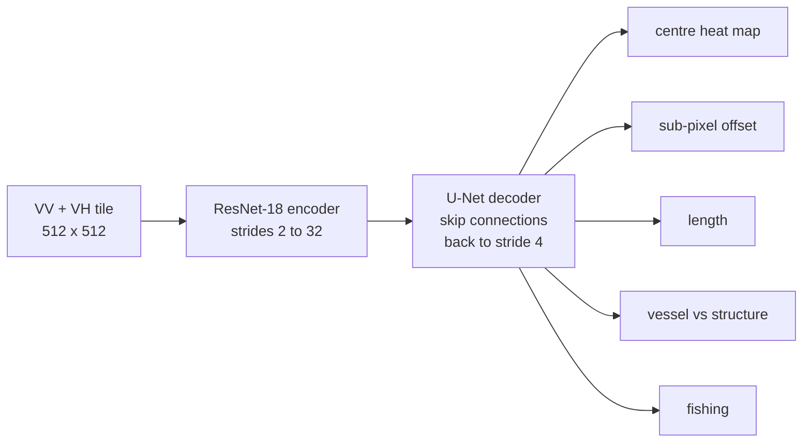

**Outputs:** The network predicts, on a grid at a quarter of the input resolution (40 m cells):

- a heat map of object centres;
- a sub-cell offset;
- length, regressed as log(1 + metres);
- vessel and fishing probabilities.

Detections are local maxima of the heat map above a threshold.

**Training losses:**

- Heat map: CenterNet focal loss.
- Length and offset: L1.
- Vessel and fishing: binary cross-entropy, applied only where labelled.

**Why this design:**

- **Labels are points, not boxes:** A heat-map peak is the natural output. The xView3 reference model, a Faster
  R-CNN on boxes invented from points, scored a detection F1 of 0.43.
- **Ships are a few pixels wide and often side by side:** A U-Net decoder restores spatial detail that the encoder's
  downsampling removes. The xView3 winner used the same family: a CenterNet-style "CircleNet" with an EfficientNet
  encoder and output at stride 2.
- **Compute:** ResNet-18 trains on a free Kaggle T4 and runs inference on 2 ARM cores. That is why we kept stride 4
  and a small encoder.
- **Licence:** torchvision only. YOLO (AGPL) was ruled out.

**Baseline:** Cell-averaging CFAR (constant false alarm rate) on VV, the classical radar ship detector.

### 3.2 Matching detections to AIS

1. Estimate each AIS ship's position at the exact acquisition time of its image line, by interpolating between
   reports or dead-reckoning from the nearest one.
2. Pair ships with detections by Hungarian assignment within 300 m.

Moving targets in SAR images are displaced along the satellite track by (R/V) × radial speed, which reaches hundreds
of metres. The gate is stretched along-track for each ship by that amount.

A detection with no match is a dark candidate only if all of the following hold:

- estimated length ≥ 50 m;
- no detection within 100 m on another pass (which would mean a fixed structure);
- the area's grid cell heard ≥ 3 AIS ships in the past 7 days;
- the feeds heard ≥ 50% of the usual number of ships around the cell at that hour.

### 3.3 Length head fine-tuned on Baltic data

The detector's length output was about 4× too short on Baltic scenes; on xView3 it had been accurate. We froze the
entire network and retrained only the length head (a 3×3 convolution, a ReLU and a 1×1 convolution, about 37,000
parameters). Training data was 96 × 96 px cut-outs of AIS-matched ships, labelled with their AIS-reported length;
the loss was L1 on log(1 + m).

### 3.4 Evidence check: gap-surprise model

For each dark candidate, we search for an AIS ship whose reporting gap spans the image time and whose track passes
within 2 km.

The silence is then scored by a coverage model. For each H3 hexagon it estimates how often a silence exceeds 30
times the expected report interval, using rates shrunk toward the parent hexagon (empirical Bayes). One generalised
Pareto tail, fitted by maximum likelihood, describes how far silences run beyond that. Gap surprise is −log₁₀ P.

### 3.5 Risk ranking: logistic regression

Vessel-week features:

- silences while moving, with their surprise;
- open-sea loitering;
- meetings alongside other ships away from port;
- identity changes;
- position jumps;
- radar links;
- tanker, length.

Listed vessels are positives and all others are unlabelled (positive-unlabelled learning). We used L2 logistic
regression with balanced class weights, chosen over gradient boosting for readable per-feature reasons and for
robustness with 106 positives. Baselines: an Isolation Forest (no labels), and the rule "tanker that called at a
Russian port".

## 4. Experimental results

### 4.1 Input-layer selection (ablation, tiles, one seed each)

| inputs | F1 detect | vessel F1 | near-shore recall |
|---|---|---|---|
| CFAR (VV) | 0.286 | | |
| VV, VH | 0.780 | 0.845 | 0.336 |
| locally normalised VV, VH | 0.763 | 0.822 | 0.451 |
| + VV − VH | 0.789 | 0.898 | 0.479 |
| + bathymetry, land mask | 0.757 | 0.806 | 0.320 |
| + wind speed and direction | 0.759 | 0.825 | 0.408 |

Ancillary layers gave no gain and made epochs 2 to 4× slower. Differences between runs (0.757 to 0.789) were smaller
than the epoch-to-epoch swings of up to 0.13, so the training recipe was fixed before comparing again.

### 4.2 Training recipe and 3-seed confirmation

| hyperparameter | value |
|---|---|
| optimiser | AdamW, peak learning rate 2 × 10⁻⁴ |
| schedule | 1-epoch linear warm-up, cosine decay to 0 |
| epochs | 12, fixed (no early stopping) |
| evaluation weights | exponential moving average, decay 0.999 |
| detection threshold | swept 0.25 to 0.75 on the mining scenes |

| inputs (3 seeds each) | F1 detect | vessel F1 | fishing F1 | near-shore recall |
|---|---|---|---|---|
| VV, VH | 0.783 ± 0.004 | 0.922 ± 0.003 | 0.756 ± 0.004 | 0.556 ± 0.002 |
| local VV, VH, VV − VH | 0.783 ± 0.001 | 0.920 ± 0.002 | 0.741 ± 0.013 | 0.554 ± 0.002 |

Under the stable recipe the two input sets tie, so the simpler VV, VH was kept.

### 4.3 Model selection on whole held-out scenes

Whole scenes are about 95% empty sea, so they are harder than tiles.

| model | threshold | P | R | F1 detect | F1 shore | aggregate | false alarms |
|---|---|---|---|---|---|---|---|
| CFAR (z = 6) | | 0.034 | 0.471 | 0.063 | 0.058 | 0.021 | 35,137 |
| V5: 3-seed ensemble | 0.40 | 0.694 | 0.742 | 0.717 | 0.433 | 0.547 | 851 |
| V6: + hard negatives | 0.45 | 0.882 | 0.676 | 0.765 | 0.451 | 0.586 | 234 |
| **V7: + no AIS-only scenes** | **0.45** | **0.872** | **0.694** | **0.773** | **0.446** | **0.590** | **265** |

V7 is the production model. Per scene, its detection F1 ranges from 0.65 to 0.93 (median 0.80).

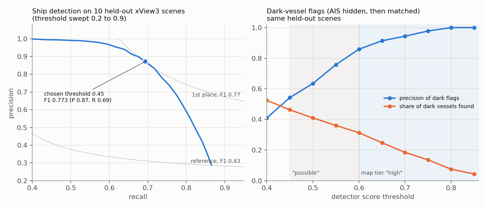

**Confidence for dark candidates:** We simulated dark-vessel detection on the held-out scenes: hide AIS, run the
matching, and score which flags were real dark vessels (right panel). At a score of 0.6 or more, 86% of flags were
correct and 31% of dark vessels were found. Between 0.45 and 0.6, about 40% were correct. These became the map's
"high" and "possible" tiers.

### 4.4 Live Baltic results

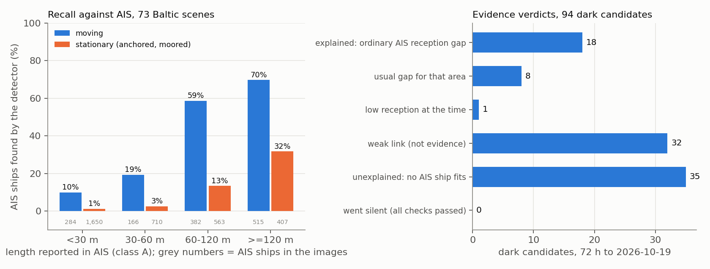

**Recall (73 scenes, 10 to 14 Oct, 7,326 AIS ships):**

- Moving class A ships ≥ 60 m: 65%, with no dependence on wind (59 to 69% across four sea-state bands).
- Moored ships and boats under 30 m are mostly missed.

**False alarms:** At most 16.5% of confident vessel detections in covered water lacked AIS, an upper bound on the
false-alarm rate.

**Fixed structures and small craft:** Rules removed 161 of the first 199 raw dark candidates: small craft, fixed
structures seen on repeat passes, and areas outside the target sea.

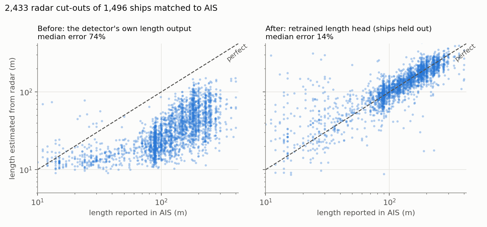

**Length:** Median error fell from 74% to 14%, with 74% of ships within 25% of their true length. A size check
(radar length between 0.5× and 2× the AIS length) keeps 95% of true matches.

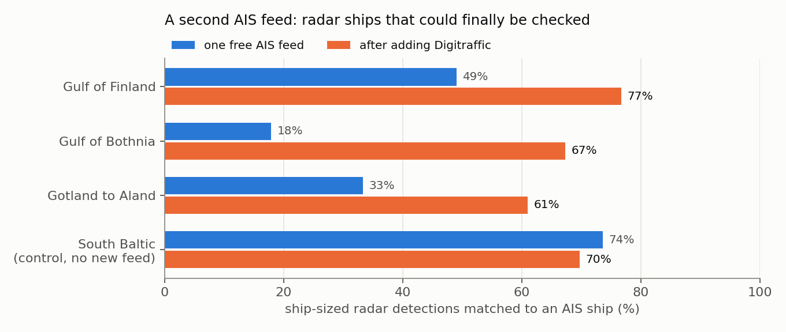

**Second AIS feed:** Adding Digitraffic was a natural experiment, with the south of the Baltic as an untouched
control. For the same 717 ships, silences of 45 minutes or more fell 55% in the Gulf of Finland and 57% in the
Gulf of Bothnia.

**Evidence check (94 candidates, 16 to 19 Oct):**

- 18 explained by ordinary reception gaps.
- 8 usual gaps for the area.
- 1 low reception.
- 32 weak links.
- 35 with no AIS ship fitting.
- 0 passed every check.

A null test supports the links: moving each candidate 15 km at random cut close links from 15 to 2.

### 4.5 Risk ranking

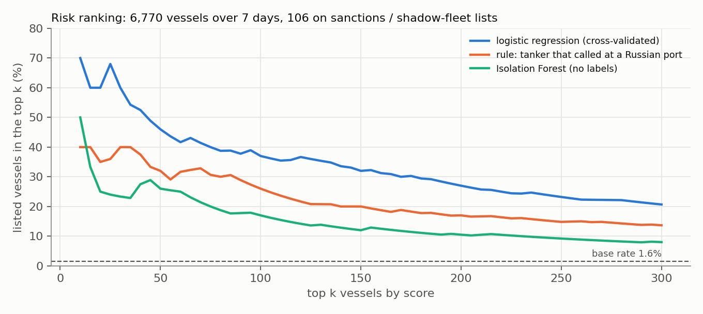

| method (6,770 vessels, 106 listed, 12 to 19 Oct) | ROC-AUC | average precision | precision, top 50 |
|---|---|---|---|
| logistic regression, 10 × 5-fold CV | 0.882 ± 0.007 | 0.294 ± 0.011 | 0.46 ± 0.03 |
| rule: tanker at a Russian port | 0.879 | 0.167 | 0.32 |
| Isolation Forest, same features | 0.857 | 0.116 | 0.26 |

**Feature selection by ablation:**

- **Russian-port hours removed:** Average precision rose by 0.031 and was higher on all 10 shuffles. The feature
  promoted Russian domestic tankers.
- **Position jumps counted only where fewer than 5 ships jumped:** Jumps clustered in the eastern Gulf of Finland,
  an area effect consistent with GNSS interference.

**Later-week test:** Trained on 12 to 19 October and tested on the following week, 19 to 26 October, which the
model never saw. Intervals are 95% bootstrap intervals over test vessels.

| test week (19 to 26 Oct) | vessels | listed | model: average precision | rule: average precision | model: precision, top 50 | rule: precision, top 50 |
|---|---|---|---|---|---|---|
| all vessels | 6,611 | 109 | **0.317** | 0.207 | **0.54** | 0.40 |
| vessels not seen in the training week | 1,150 | 27 | **0.426** (0.24 to 0.60) | 0.143 (0.07 to 0.26) | **0.28** | 0.14 |

- The model beat the rule on both groups. The gain in average precision was 0.01 to 0.21 for all vessels and 0.10 to
  0.45 for unseen vessels (95% intervals), so neither gain is likely to be chance.
- Of the 27 listed vessels new to the area, 19 were tankers but only 3 called at a Russian port that week, so the
  rule ranked most of them low.
- An earlier 3-day test (13 to 16 October against 16 to 19 October) had shown almost no gain on unseen vessels
  (0.10 against 0.08, from 15 listed vessels). The full week, with nearly twice as many, reverses that.
- Labels use the watchlist as of 1 November, so vessels listed after the test week count as listed in it.

## 5. Visual detection results

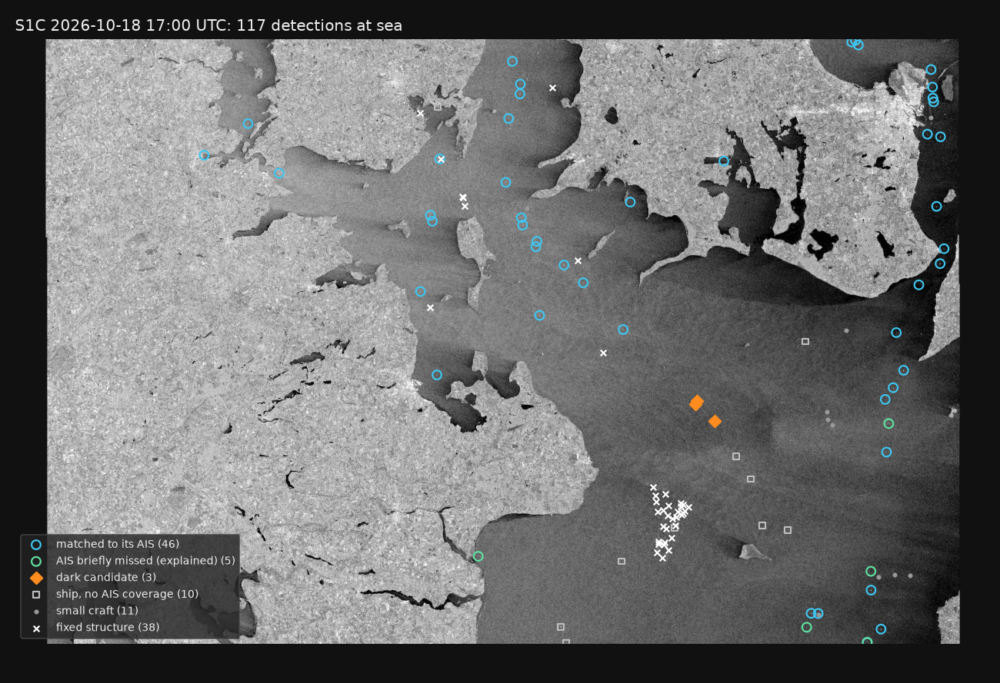

**One full scene** (Sentinel-1C, 18 October 2026, 17:00 UTC, Danish straits), shown at 1/8 resolution. Of 117
detections at sea:

- 46 matched to an AIS ship;
- 5 explained AIS gaps;
- 3 dark candidates;
- 10 ships in water without AIS coverage;
- 11 small craft;
- 38 fixed structures, including an offshore wind farm (the cluster of crosses, bottom centre) that the
  repeat-pass rule recognised.

**Full-resolution zooms:** Three 7 × 7 km windows from the same scene, at full 10 m resolution.

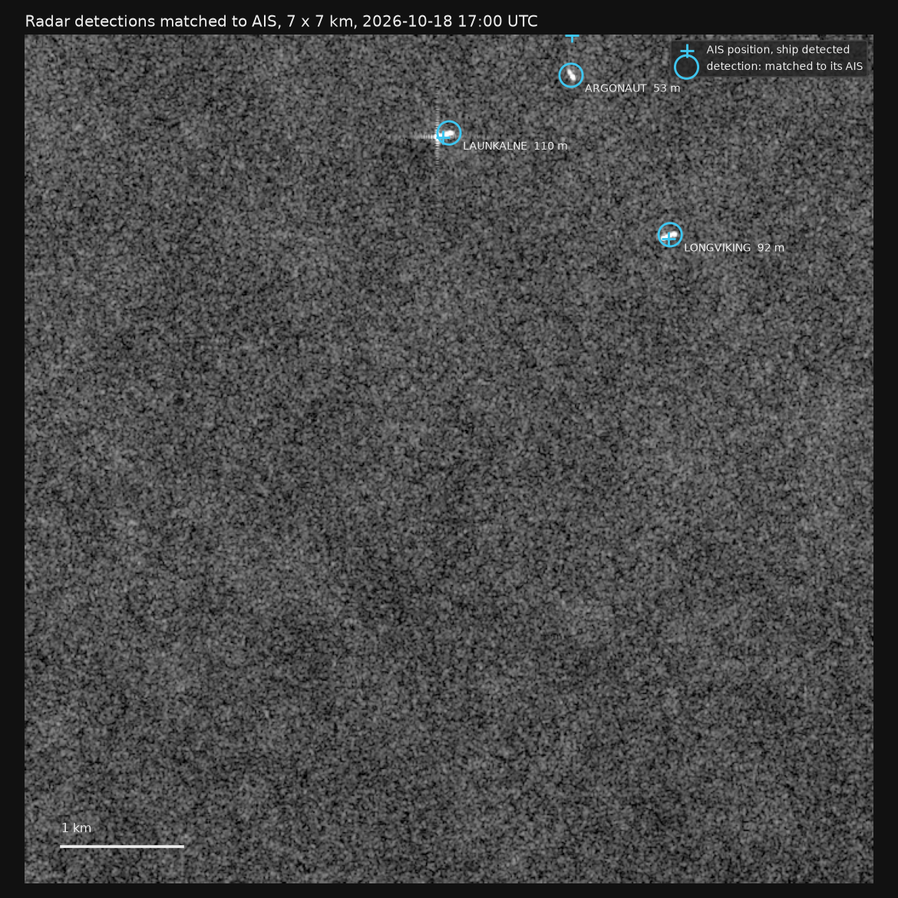

- Matched ships: each blue circle is a detection, and each blue cross is that ship's AIS position interpolated
  to the image time. Names and lengths come from AIS. The cross sits on or next to the radar return in every case.

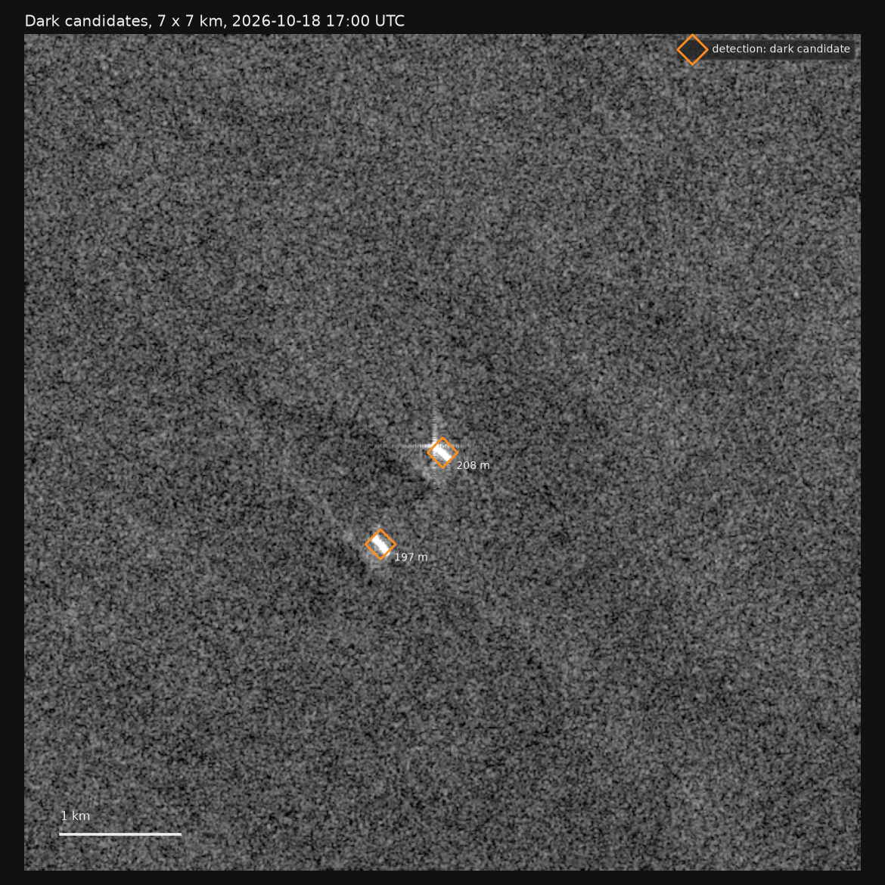

- Dark candidates: two returns of about 200 m (the length head's estimate), under 1 km apart, with no AIS
  position inside the matching gate. These are candidates before the evidence checks in section 4, not
  confirmed dark ships.

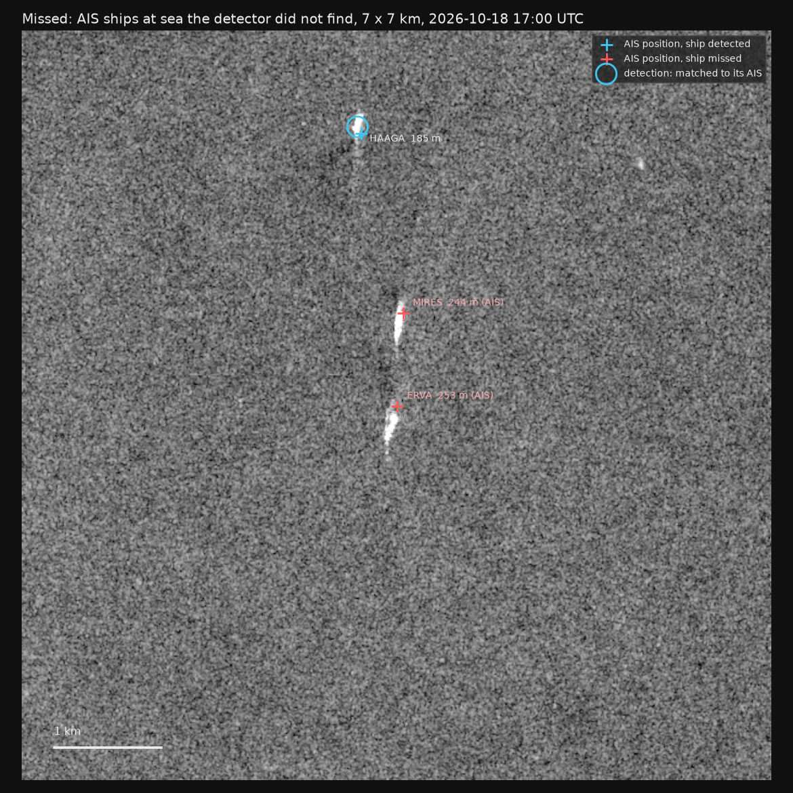

- Missed ships: red crosses are AIS ships the detector did not find. MIRES (244 m) and ERVA (253 m) are
  plainly visible but were not detected, while HAAGA (185 m) just above them was. Both missed returns are
  long and smeared along the flight direction, a shape that is less common in the training data.

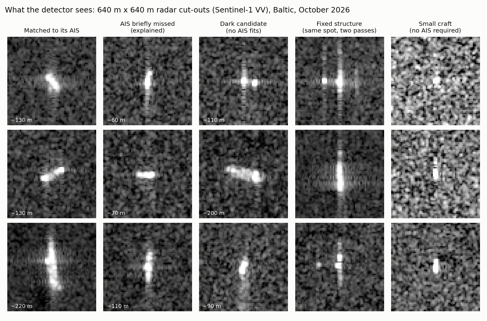

**Cut-outs:** Each panel is 640 × 640 m of Sentinel-1 VV.

- Ships matched to AIS appear as bright elongated returns, often with cross-shaped sidelobes.
- Fixed structures show the same signature on every pass.
- Small craft are a few pixels and close to the noise floor.

## 6. Comparison with xView3

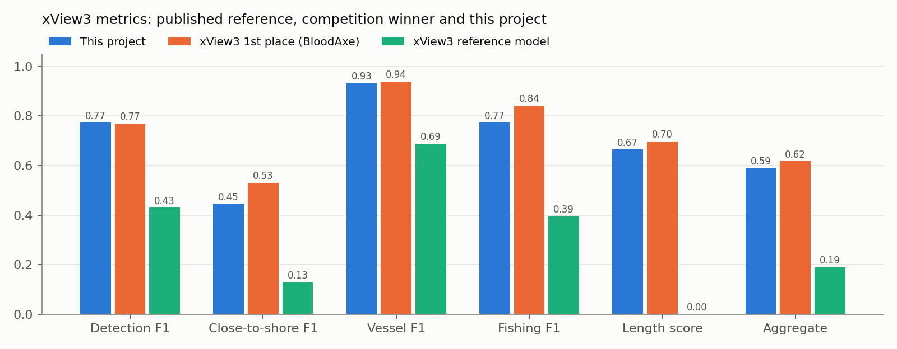

| | F1 detect | F1 shore | vessel F1 | fishing F1 | length | aggregate |
|---|---|---|---|---|---|---|
| xView3 reference model | 0.430 | 0.129 | 0.689 | 0.395 | 0.000 | 0.190 |
| xView3 1st place (BloodAxe) | 0.770 | 0.531 | 0.939 | 0.843 | 0.697 | 0.618 |
| xView3 5th place | 0.734 | 0.453 | 0.938 | 0.791 | 0.711 | 0.572 |
| **this project** | **0.773** | **0.446** | **0.933** | **0.773** | **0.665** | **0.590** |

Reference and competition numbers: xView3 paper, Table 1, holdout set. Ours: 10 held-out validation scenes.

**What matches:**

- Same metric, reimplemented from the reference definition.
- Thresholds were never tuned on test scenes.
- Whole scenes, not tiles.

**What differs:**

- Our test set is 10 validation scenes; the competition used 237 holdout scenes, so our numbers have a wider margin
  of error and are indicative.
- The winning solutions trained on the full dataset with larger ensembles and many more GPU hours. Ours is a
  ResNet-18, 3-seed ensemble trained on free hardware (about 20 GPU hours for all experiments), with a single model
  in production.

**Reading:** Detection and vessel classification are at the level of the top five. Close-to-shore detection
(0.45 against 0.53) and fishing classification (0.77 against 0.84) are the gaps. Both are consistent with our
coarser output stride (4 against 2) and less training data.

## 7. Discussion

**What worked:**

- **Labels mattered more than architecture:** Training on manually labelled scenes and adding hard negatives moved
  detection F1 from 0.717 to 0.773. Input layers and recipe changes within noise did not.
- **Fixing the training recipe before comparing:** Fixed epochs, a cosine schedule, an EMA of the weights and 3
  seeds turned an apparent gain into a measured tie.
- **Free labels from AIS:** AIS served as an answer key for recall, as labels for the length head (74% → 14% error),
  and as the basis for every evidence verdict.
- **Checking every dark candidate against coverage:** Outages, low reception and chronic blind spots explained every
  apparent switch-off. A second feed measurably closed coverage gaps.

**Limitations:**

- The detector has not been scored on hand-labelled Baltic scenes. AIS measures recall for broadcasting ships, not
  false alarms or near-shore performance.
- Near-shore detection (F1 0.45) and small craft are weak. Sea ice is untested.
- "Dark" can only be called where free AIS feeds hear ships.
- The risk score is a ranking, not a calibrated probability, and the later-week test rests on one week with 27
  listed vessels the model had not seen.
- The xView3 comparison uses different test scenes.

**Conclusions supported by the results:**

1. A detector trained on xView3 transfers to the Baltic: 65% recall on large moving ships, with xView3 scores at the
   level of the competition's top five.
2. Dark candidates can be given a calibrated confidence tier from the detector score (86% precision at ≥ 0.6 in
   simulation).
3. With free AIS coverage, apparent dark vessels in the Baltic were, in this period, explained by reception rather
   than switch-offs. Improving coverage is the largest lever for finding real ones.
4. Behaviour predicts listing beyond the obvious rule: on a later week, the risk model ranked listed vessels better
   than "tanker at a Russian port", including vessels it had never seen (average precision 0.43 against 0.14).

**Next steps:**

- Hand-label a few Baltic scenes.
- Use a stride-2 output head for near-shore detection.
- Compare with Global Fishing Watch's published Sentinel-1 detections.
- Retrain the risk model weekly and track its later-week score over several weeks.
- Extend to other regions (Strait of Hormuz, South China Sea, Malaysian transfer hubs) by adding a region file under
  `configs/regions/`.

## Data and credits

- **AIS:** [aisstream.io](https://aisstream.io)
- **AIS:** [Fintraffic Digitraffic](https://www.digitraffic.fi/en/marine-traffic/). Source: Fintraffic /
  digitraffic.fi, license [CC 4.0 BY](https://creativecommons.org/licenses/by/4.0/)
- **Radar imagery:** contains modified Copernicus Sentinel-1 data, from the
  [Copernicus Data Space Ecosystem](https://dataspace.copernicus.eu/)
- **Watchlist:** [OpenSanctions](https://www.opensanctions.org/) maritime dataset
- **Detector training data:** [xView3-SAR](https://iuu.xview.us/)
  ([paper](https://arxiv.org/abs/2206.00897); reference and competition scores from its Table 1)
- **xView3 first-place solution, used for comparison:**
  [CircleNet README](https://github.com/efcaguab/sar-vessel-detector)
- **Land polygons:** © [OpenStreetMap](https://www.openstreetmap.org/copyright) contributors (ODbL), via
  [osmdata.openstreetmap.de](https://osmdata.openstreetmap.de/data/land-polygons.html)
- **Figures:** rebuilt from the project's data by `docs/make_figures.py`

## Running it

```bash
uv venv && source .venv/bin/activate
uv pip install -e ".[dev,app,sar,infer]"
pytest

maritime stream --region baltic        # live AIS (free aisstream.io key in .env, see .env.example)
maritime digitraffic --region baltic   # second live AIS feed, Finnish shore stations (no key needed)
maritime serve --region baltic         # the map at http://localhost:8000
MARITIME_PUBLIC=1 maritime serve --region baltic   # public mode: rate limits, caching, no API docs

maritime sanctions update              # OpenSanctions watchlist
maritime sar land                      # once: land polygons for the region
maritime sar run --hours 48            # new Sentinel-1 scenes -> detections matched to AIS (Copernicus account in .env)
maritime sar evidence --hours 72       # evidence verdicts for dark candidates
maritime risk --days 7                 # vessel risk ranking
```

Detector weights are not included: they were trained on xView3 data, which is available for registered use only.
The training notebooks are in `notebooks/`.

## Repository layout

| path | what |
|---|---|
| `src/maritime/sar/` | Sentinel-1 search, download and calibration; detector; scene pipeline; length head; evidence check; validation report; figures |
| `src/maritime/fusion.py` | AIS position at image time, Doppler-aware matching |
| `src/maritime/features/` | AIS gaps, region-wide outages, the gap-surprise coverage model |
| `src/maritime/risk.py` | behaviour features per vessel-week and the risk model |
| `src/maritime/live/` | AIS recorders (aisstream websocket, Digitraffic REST) |
| `src/maritime/sanctions.py` | OpenSanctions watchlist and IMO/MMSI matching |
| `src/maritime/web/` | FastAPI backend, deck.gl map, and the protections for serving it publicly (`guard.py`) |
| `notebooks/` | xView3 training and evaluation (run on Kaggle) |
| `docs/` | figures, and `make_figures.py`, which rebuilds them from the project's data |
| `tests/` | unit tests |

## License

Code: MIT (see `LICENSE`). The vendored deck.gl and MapLibre builds in `src/maritime/web/static/vendor/` keep their
own licences, included next to them. Data keeps the terms of its sources listed above.
